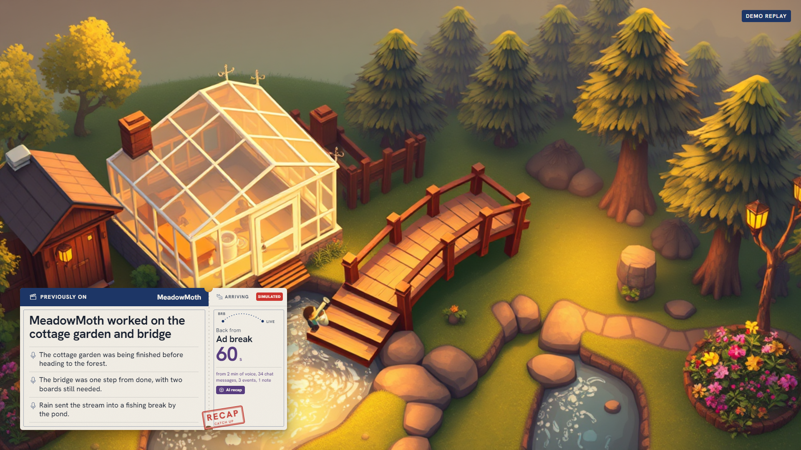
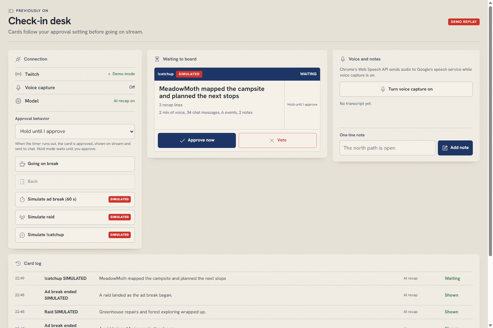

# Previously On

Viewers who come back from an ad break, or join mid-stream, get a 15-second recap of what they missed.

Previously On is for small streamers who lose viewers at every break and viewers who arrive after the stream has started. Raids are also supported.

[Video: coming soon]

## Screenshots





## Proof

- [Real Twitch and OBS tests](docs/VERIFICATION.md)
- Run `npm test`. The suite covers source grounding, fallback behavior, approval and veto, catch-up cooldowns, EventSub keepalives, and clock skew.
- [Build notes and Codex session details](BUILT_WITH_CODEX.md)

## Try it in 2 minutes

```sh
npm install
npm run demo
```

The demo needs no Twitch account or API key. With `OPENAI_API_KEY` set, it uses structured model recaps; without it, it uses the deterministic fallback.

Open the overlay at [http://127.0.0.1:4777/overlay](http://127.0.0.1:4777/overlay) and the control panel at [http://127.0.0.1:4777/control](http://127.0.0.1:4777/control). The demo replays a sample session and runs simulated triggers. In the panel, use **Simulate raid** or **Simulate !catchup**, then approve or veto the waiting card.

## How it works

| Trigger | Twitch event or API | Result |
|---|---|---|
| Ad break | EventSub `channel.ad_break.begin`; Helix `POST /helix/chat/messages` for the recap line | Recap after the break ends; ad events require an affiliate or partner channel |
| `!catchup` | EventSub `channel.chat.message`; Helix `POST /helix/chat/messages` | Reply to the requester; show a ticket when cooldown rules allow |
| Back from break | Control panel action; Helix `POST /helix/chat/messages` for the recap line | Recap ticket and chat line |
| Raid | EventSub `channel.raid`; Helix `POST /helix/chat/messages` for the welcome line | Welcome ticket and chat line for the raiding channel |

The recap selects recent chat, voice transcripts and streamer notes as content; EventSub events remain in the buffer for provenance counts only. The OpenAI Responses API returns structured output. A grounding check drops bullets that cite unknown sources or contain blocked terms. Refused, incomplete, timed-out or ungrounded model output uses the deterministic fallback.

The control panel offers auto-approval after 5, 10 or 20 seconds, or **Hold until I approve**. When an auto-approval timer runs out, the card is approved, shown on stream and sent to chat. Hold mode never approves or posts automatically; the streamer must approve the card.

The server binds to `127.0.0.1`; secrets belong in `.env`. Chrome's Web Speech API sends voice audio to Google's speech service. Chat, transcript text and notes go to OpenAI only for a recap call. The app sends approved recap lines to Twitch.

## Run it on your channel

Register a Twitch application as a **public client** in the Twitch developer console. Use Device Code Grant Flow; this app does not use a client secret. Copy `.env.example` to `.env` and set `TWITCH_CLIENT_ID` and `TWITCH_CHANNEL`. Device authorization requests `user:read:chat`, `user:write:chat`, `user:bot`, `channel:read:ads` and `moderator:read:followers`. Set `OPENAI_API_KEY` to enable model recaps; it is optional. `OPENAI_MODEL` defaults to `gpt-5.4-mini`.

```sh
npm install
npm start
```

Follow the device authorization prompt in the terminal. Add an OBS Browser Source using `http://127.0.0.1:4777/overlay`, set its width to 1920 and height to 1080, and keep the browser source background transparent. Open `http://127.0.0.1:4777/control` in Chrome for moderation, approval timing, voice capture and notes.

## What was tested on real Twitch

Live tests are documented in [docs/VERIFICATION.md](docs/VERIFICATION.md). When `results/live-cards.jsonl` has records, run `npm run live-report` for counts by trigger and status and latency percentiles.

## Limits, said plainly

- Ad breaks require an affiliate or partner channel. On other channels, use the simulated ad break; simulated cards are labeled SIMULATED.
- Voice capture requires Chrome's Web Speech API, which sends audio to Google's speech service.
- Recaps are only as good as the recent chat, voice and notes available in the source window.
- One channel runs per process.

## Built with Codex

Codex session ID: `01a174cd-3a2a-7f21-a9bf-1289a1e0b57a`.

The build ran in one Codex thread across eight prompts. Each prompt was written from the review of the previous block, and the resulting fixes were tested before the next prompt.

More build details are in [BUILT_WITH_CODEX.md](BUILT_WITH_CODEX.md).

## License

MIT. See [LICENSE](LICENSE).
