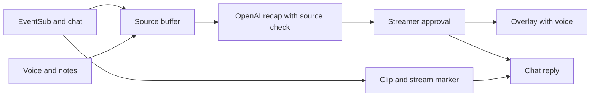

# Previously On

Viewers who come back from an ad break, or join mid-stream, get a 15-second recap of what they missed.


Try it in your browser, no install: https://kasbsquall.github.io/previously-on/

Video: coming soon.

- It fires when an ad break starts through EventSub `channel.ad_break.begin`, then shows the recap when the break ends.
- It plays on stream for everyone, so viewers install nothing.
- Every recap line cites stream moments; the streamer can approve, veto or hold each card.

## Proof

| Check | Result |
|---|---|
| Live Twitch `!catchup` | A recap used the viewer's three chat messages, written in Spanish, and returned in English. |
| Live Twitch raid | EventSub delivered the raid and a card reached the overlay; that first test had no other recap sources in its window. |
| OBS | Ticket displayed in OBS 32.1.2 at 1920x1080. |
| Model evaluation | 3 cards; 9 bullets kept, 0 dropped; fallback rate 0; p50 2,738 ms, p95 3,429 ms. This is a synthetic fixture evaluation, not live latency. |
| Tests | 68 passed with `npm test`; the suite covers grounding, fallback, veto, cooldowns, keepalive, clock skew and the recorded demo format. |

Details and limits are in [docs/VERIFICATION.md](docs/VERIFICATION.md). Evaluation data: [results/eval-2026-10-27.json](results/eval-2026-10-27.json).

## How it works



The recap uses recent chat, voice transcripts and notes. EventSub events stay in the buffer for provenance, not recap text. OpenAI returns structured output; a grounding check removes bullets that cite unknown sources or contain blocked terms. Refusal, incomplete output, a timeout or a failed check uses the deterministic fallback.

## Try it locally

```sh
npm install
npm run demo
```

The demo needs no Twitch account or API key. Add `OPENAI_API_KEY` to `.env` to use model recaps and narrator voice; without it the demo uses the deterministic fallback and runs silently. Open the panel at `http://127.0.0.1:4777/control` and overlay at `http://127.0.0.1:4777/overlay`. Use **Simulate raid**, **Simulate !catchup**, or **Simulate ad break (60 s)**, then approve or veto the pending card.

## Triggers and settings

| Trigger | Source | Result |
|---|---|---|
| Ad break | EventSub `channel.ad_break.begin`; real triggers request a clip and stream marker | Card and chat line when the break ends |
| `!catchup` | EventSub `channel.chat.message` | Chat reply; overlay card when cooldown rules allow |
| Back from break | Panel buttons | Card and chat line for the time before the break |
| Raid | EventSub `channel.raid`; real triggers request a clip and stream marker | Welcome card and chat line |

Ad breaks need an affiliate or partner channel. The panel can auto-approve after 5, 10 or 20 seconds, or **Hold until I approve**. When the timer runs out, the card is approved, shown and posted to chat; hold mode waits for the streamer and never posts automatically. Narrator voice and sound effects are on by default and can be toggled independently. Missing clip scopes or Twitch API errors do not block a card; simulated triggers skip clip and marker calls.

## Privacy

The server binds only to `127.0.0.1`; put secrets in `.env`. Chrome's Web Speech API sends captured voice audio to Google's speech service. Chat, notes, transcript text and card text go to OpenAI for recaps and narrator audio. OBS Browser Source audio must be enabled to hear narration and sound effects. Approved recap lines and confirmed clip links are sent to Twitch chat.

## Run it on your channel

Register a Twitch application as a **public client** and use Device Code Grant Flow; no client secret is used. Copy `.env.example` to `.env`, set `TWITCH_CLIENT_ID` and `TWITCH_CHANNEL`, then run:

```sh
npm install
npm start
```

Complete the device authorization shown in the terminal. Add `http://127.0.0.1:4777/overlay` as an OBS Browser Source, set it to 1920x1080 with a transparent background, and enable browser-source audio. Open `http://127.0.0.1:4777/control` in Chrome. `OPENAI_API_KEY` enables model recaps and narration; `OPENAI_MODEL` defaults to `gpt-5.4-mini`.

## Built with Codex

Codex session ID: `01a174cd-3a2a-7f21-a9bf-1289a1e0b57a`.

The build ran in one Codex thread across twelve prompts. Each prompt was written from the review of the previous block. See [BUILT_WITH_CODEX.md](BUILT_WITH_CODEX.md).

## License

MIT. See [LICENSE](LICENSE).
